<h1 align="center">Tix</h1>

<strong>Le compagnon quotidien pour gérer vos remboursements</strong> 
<em>Your everyday companion for managing expense claims</em>

  <a href="https://github.com/karimbel/Tix-showcase/releases/latest/download/tix.apk"><strong>Télécharger / Download (.apk)</strong></a>
  ·
  <a href="https://github.com/karimbel/Tix-showcase/releases/latest">Dernière version / Latest release</a>

---

## Français

**Fini les tickets perdus et les notes de frais bouclées dans la précipitation.** Tix transforme chaque ticket, reçu ou facture en une ligne claire, prête à être remboursée. Scannez, vérifiez en quelques secondes, c'est classé.

| | |
| :--- | :--- |
| 📷 **Scannez** | Numérisez le document avec votre téléphone : bords détectés, image redressée, jusqu'à 30 pages. Le même scanner que l'application Fichiers de Google. |
| 🧮 **Calculez** | Tix lit le montant TTC, la date et le commerçant pour vous. Vous corrigez en un geste si besoin, et le **total du mois** se met à jour tout seul. |
| 🗂️ **Classez** | Catégories (Repas, Transport, Fournitures, Hébergement, Autre, et les vôtres), navigation par mois, filtre par catégorie, recherche dans le texte du document. |
| 📤 **Exportez** | Trois formats pour le mois choisi : un **CSV** prêt pour Excel, un **ZIP** avec le CSV et les scans (photos nommées par date, commerçant et montant), ou un **rapport PDF** avec un tableau (visuel, date, commerçant, catégorie, note, montant) et le total. À envoyer par e-mail ou Drive à votre comptable ou à votre employeur. Chaque document peut aussi être partagé seul, en images ou en PDF multipage. |

### Aperçu

<table>
<tr><td align="center" width="33%">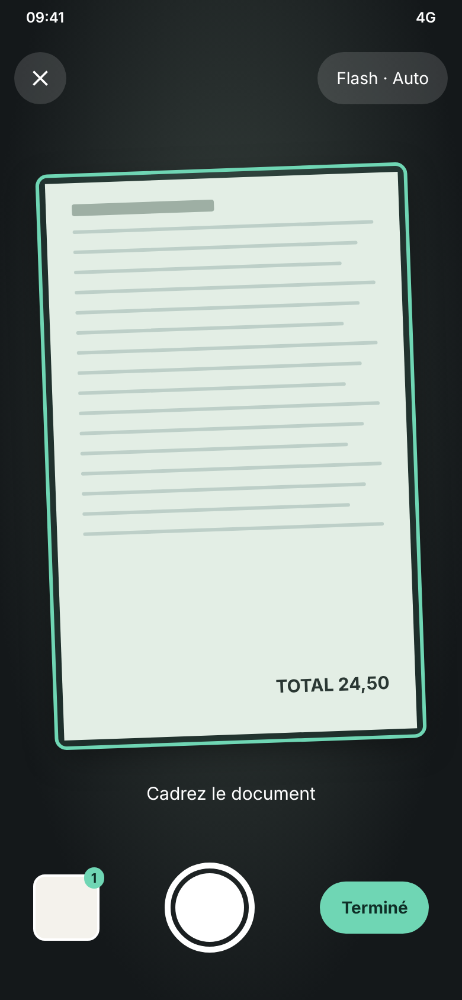 Scanner</td><td align="center" width="33%">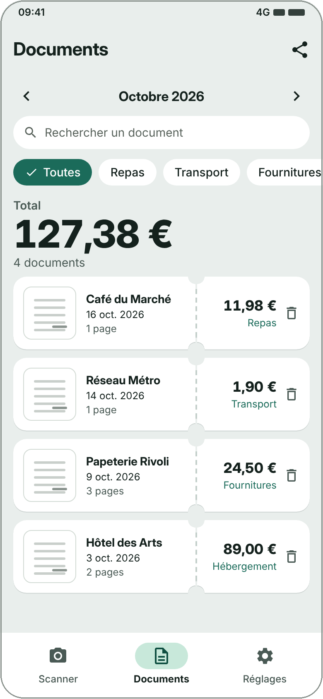 Documents</td><td align="center" width="33%">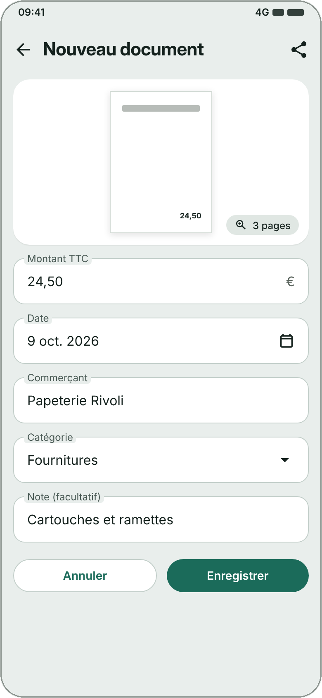 Vérification</td></tr>
<tr><td align="center" width="33%">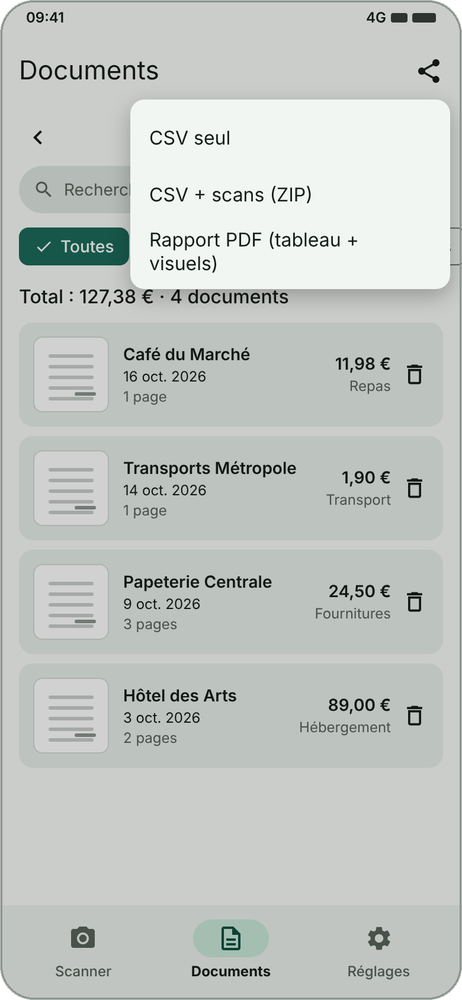 Export</td><td align="center" width="33%">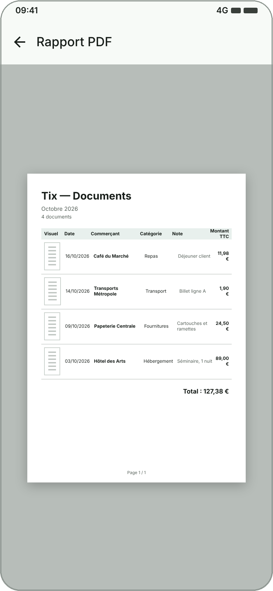 Rapport PDF</td><td align="center" width="33%">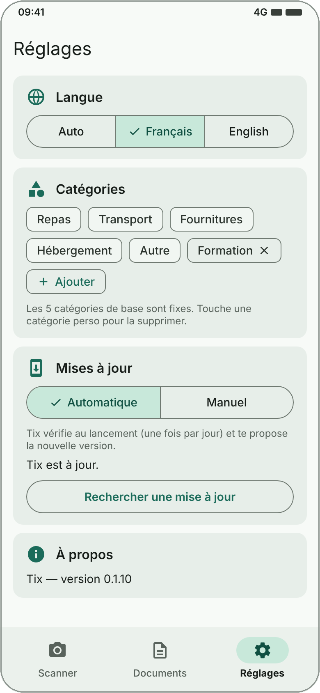 Réglages</td></tr>
</table>

Écrans à titre illustratif : les données affichées sont fictives et l'interface peut légèrement évoluer.

### Pourquoi Tix

- **Rapide** : le formulaire est déjà rempli, vous ne faites que vérifier.
- **Fiable** : l'extraction n'est pas parfaite, c'est pourquoi chaque fiche reste modifiable avant d'être enregistrée. Un zoom page par page permet de contrôler le document original.
- **Privé** : aucun compte, aucun serveur. Vos documents et la lecture du texte restent sur votre téléphone.
- **Pratique** : français et anglais, mises à jour automatiques ou manuelles.

### Installation

1. Sur votre téléphone Android, téléchargez le fichier [`tix.apk`](https://github.com/karimbel/Tix-showcase/releases/latest/download/tix.apk).
2. Ouvrez-le. Si Android le demande, autorisez l'installation d'applications depuis cette source.
3. Lancez Tix.

Les versions suivantes vous sont proposées par Tix lui-même : **Réglages > Mises à jour**. Vos documents sont conservés.

> Tix est distribuée hors Google Play. Le scanner utilise les services Google Play de l'appareil.

---

## English

**No more lost receipts or rushed expense reports.** Tix turns every receipt, ticket or invoice into a clear line, ready to be reimbursed. Scan, check in seconds, done.

| | |
| :--- | :--- |
| 📷 **Scan** | Scan the document with your phone: edges detected, image straightened, up to 30 pages. The same scanner as Google's Files app. |
| 🧮 **Calculate** | Tix reads the total amount, date and merchant for you. Fix anything in one tap, and the **monthly total** updates by itself. |
| 🗂️ **Organize** | Categories (Meals, Transport, Supplies, Lodging, Other, plus your own), month-by-month browsing, category filter, search inside the document's text. |
| 📤 **Export** | Three formats for the selected month: a **CSV** ready for Excel, a **ZIP** with the CSV and the scans (images named by date, merchant and amount), or a **PDF report** with a table (preview, date, merchant, category, note, amount) and the total. Send it by email or Drive to your accountant or employer. Each document can also be shared on its own, as images or a multi-page PDF. |

### Screenshots

<table>
<tr><td align="center" width="33%">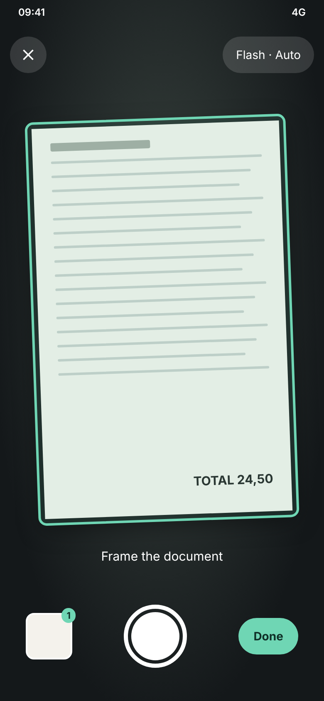 Scan</td><td align="center" width="33%">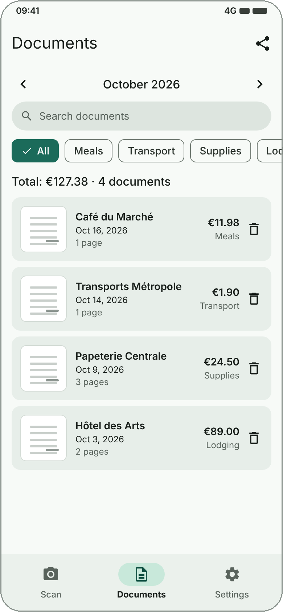 Documents</td><td align="center" width="33%">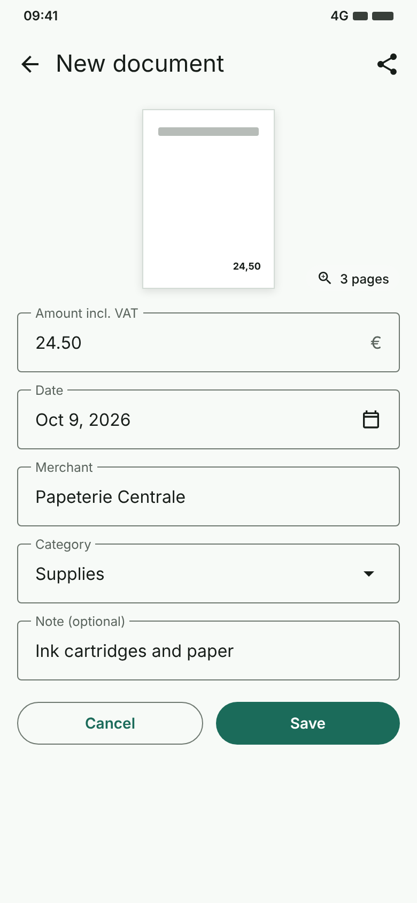 Review</td></tr>
<tr><td align="center" width="33%">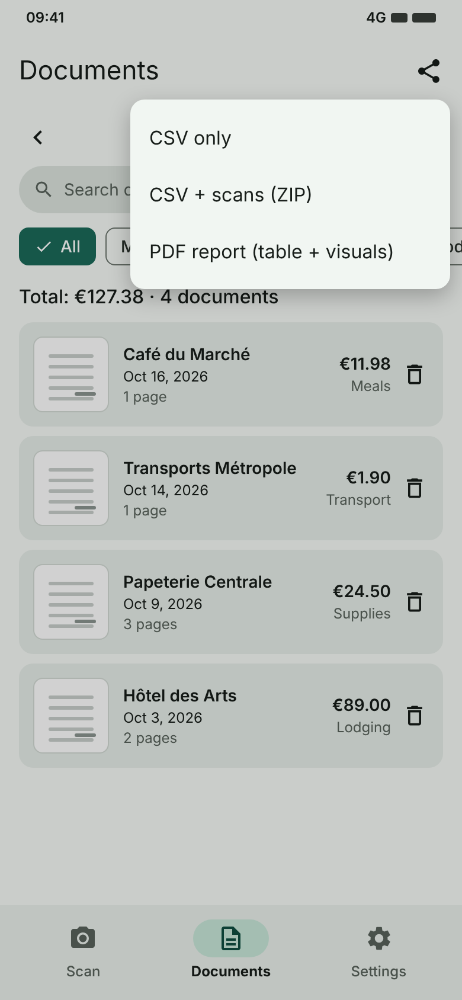 Export</td><td align="center" width="33%">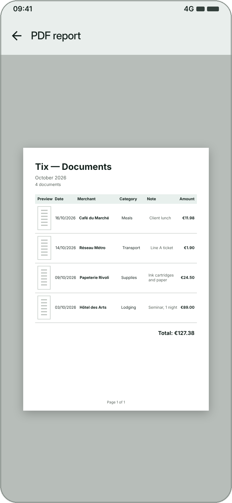 PDF report</td><td align="center" width="33%">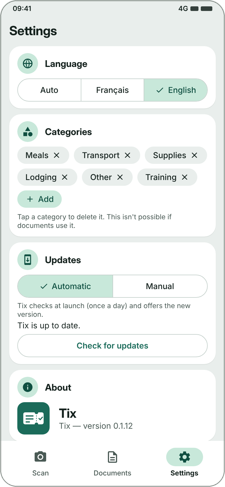 Settings</td></tr>
</table>

Screens are for illustration only: the data shown is fictional and the interface may change slightly.

### Why Tix

- **Fast**: the form is already filled in, you just check it.
- **Reliable**: extraction isn't perfect, so every entry stays editable before saving. A page-by-page zoom lets you check the original document.
- **Private**: no account, no server. Your documents and text recognition stay on your phone.
- **Convenient**: French and English, automatic or manual updates.

### Installation

1. On your Android phone, download the [`tix.apk`](https://github.com/karimbel/Tix-showcase/releases/latest/download/tix.apk) file.
2. Open it. If Android asks, allow installing apps from this source.
3. Launch Tix.

Later versions are offered by Tix itself: **Settings > Updates**. Your documents are kept.

> Tix is distributed outside Google Play. The scanner relies on the device's Google Play services.

---

Ce dépôt est la vitrine publique de Tix : présentation et téléchargements. This repository is Tix's public showcase: overview and downloads.
